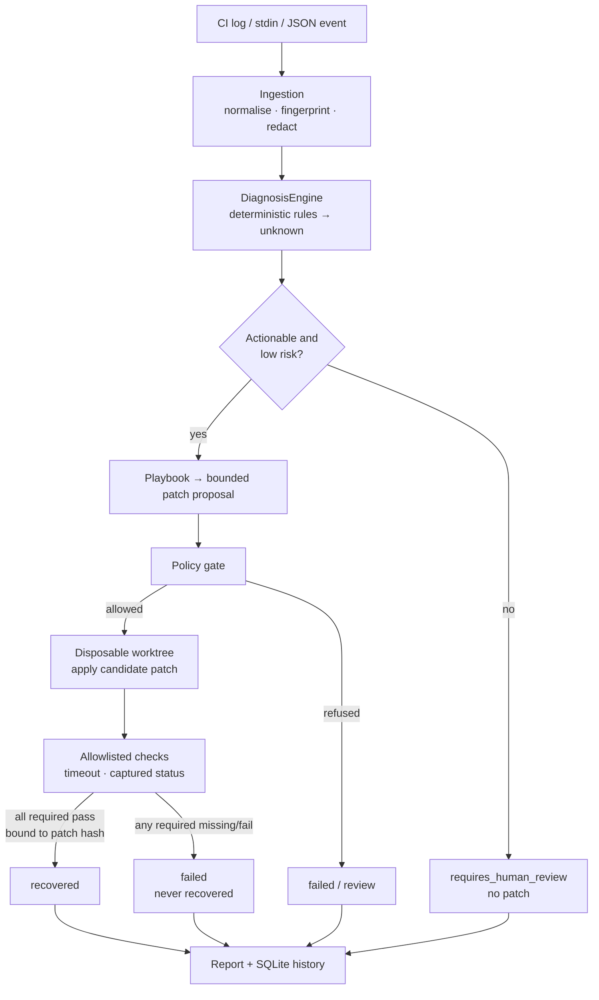

# OpenMedic

Open-source, local-first CI/CD failure diagnosis and safe-recovery assistant.

OpenMedic ingests failure evidence from CI logs, normalises and fingerprints it,
diagnoses the likely cause deterministically, proposes a bounded remediation, validates
that remediation in an isolated workspace, and reports the outcome honestly.

```
evidence → normalize/fingerprint → diagnose → propose → policy → validate → report → persist
```

## Status

**Alpha — under active development. Not production-ready.**

Capability is reported at three levels so nothing here overstates what has been proven:

| Level | Meaning |
| --- | --- |
| **Implemented & tested** | Shipped code covered by the offline suite, executed in this environment |
| **Implemented, unverified here** | Code exists and is wired up, but this environment cannot exercise it |
| **Not implemented** | Deliberately absent or still open |

### Implemented & tested

- **Deterministic diagnosis** for dependency, syntax/import, test, and build/config
  failures, plus an explicit `unknown` result — no network, no model credentials.
  24 committed engine fixtures classify exactly as recorded, and the labelled benchmark
  (15 cases) meets every committed target: type accuracy `1.0`, evidence verification
  `1.0`, rule-id match `1.0`, false recovery `0`.
- **Log/stdin/JSON ingestion** with idempotent incident creation, log classification
  hints that the engine may override with evidence, and source line metadata.
- **Secret redaction** before persistence, display, and provider transmission.
- **SQLite incident history** with versioned migrations and an explicit, tested
  lifecycle (`received → … → recovered | failed | requires_human_review`).
- **Bounded remediation proposals** with an allowlisted playbook set, patch hashing,
  and a dry-run default. Source trees are never modified by a proposal.
- **Validation** of the exact candidate patch in a disposable worktree with allowlisted
  checks, timeouts, and result capture. `recovered` requires every required check to
  have run and passed against the current patch hash.
- **Reporting** — terminal, JSON, and Markdown, each stating limitations and the
  non-automatic-merge rule.
- **Benchmarking** — the packaged corpus, the production engine, and enforced targets.
  A missed target exits `4`; CI runs the same command.
- **Optional model providers** (OpenAI, Anthropic, Gemini) behind a fallback chain with
  per-provider timeouts; **read-only GitHub integration**.
- **FastAPI surface** behind the `api` extra — a CLI-only install never imports it.

### Implemented, unverified here

- **Docker-based isolated validation.** The code path exists and is worded honestly
  ("NOT a hardened sandbox"), but Docker is not installed in this environment, so those
  tests auto-skip. Local-subprocess validation, which is what runs, is *not* a sandbox
  and must not be presented as equivalent.
- **Live provider calls.** Adapter logic is tested against mocked transports; no
  credential was used and no network call was made.
- **Python 3.11 and 3.12.** CI lists 3.11/3.12/3.13; only **3.14** has been executed in
  this environment.

### Not implemented / open

- **Contribution guidelines** (Milestone 12) — not written yet. The license question is
  settled: the project is **MIT**-licensed, see [`LICENSE`](LICENSE).
- Time-to-report, provider cost, and deterministic-coverage benchmark metrics from
  PRD §9 are not measured.
- `CheckPolicy.detect` is deliberately unwired (see `docs/IMPLEMENTATION_STATUS.md` §11.6).

## How it works



| Layer (`src/openmedic/`) | Responsibility |
| --- | --- |
| `cli` | Thin Typer transport: arguments, output format, exit codes |
| `application` | `Services` — the orchestration the CLI and API both call |
| `domain` | Contracts, enums, lifecycle transitions, errors |
| `ingestion` | Log parsing, event normalisation, classification hints, fingerprinting |
| `forensics` | Evidence extraction and quote verification |
| `diagnosis` | The deterministic rules and the engine that selects between them |
| `providers` | Optional model adapters, fallback chain, redaction before send |
| `remediation` | Playbooks, patch proposals, risk assessment, policy |
| `validation` | Disposable worktrees, check policy, execution, recovery verification |
| `persistence` | SQLite store, migrations, repository |
| `reporting` | Terminal, JSON, and Markdown renderers |
| `intelligence` | Recurrence, cascade grouping, and the benchmark |
| `api` | Optional FastAPI surface (never required by the CLI) |

Deterministic logic and optional LLM reasoning stay separate: a provider can only
enrich a diagnosis it never owns, and `provider_used` is `False` for every
deterministic result.

## Install (CLI only, no API extras)

```bash
uv sync                    # runtime dependencies only
uv run openmedic --help
```

FastAPI and uvicorn are an optional dependency group. A CLI-only install never requires
them. To include them:

```bash
uv sync --extra api
uv run openmedic api --help
```

## Quick start

Diagnose a local CI log:

```bash
uv run openmedic diagnose path/to/ci.log
```

Pipe a log in:

```bash
cat path/to/ci.log | uv run openmedic diagnose -
```

Machine-readable output for automation:

```bash
uv run openmedic --json diagnose path/to/ci.log
```

List stored incidents:

```bash
uv run openmedic incidents list
```

## Demo

A reproducible, offline walkthrough of the six things that matter:

```bash
./scripts/demo.sh
```

| # | Scenario | What it proves |
| --- | --- | --- |
| 1 | Diagnose a supported failure | `DEP-001` with quoted evidence, offline, no credentials |
| 2 | Diagnose an ambiguous log | classified `unknown` — never a guessed cause |
| 3 | `ingest` + `repair` (dry run) | a reviewable proposal, and `git status` stays empty |
| 4 | `repair --apply` | exit `4`, state `failed`, `recovered: false` — a required check failed, so recovery is refused |
| 5 | `benchmark` | every committed target met, exit `0` |
| 6 | `incidents list` / `show` | the history is queryable and reports honest outcome |

The script works from a source checkout or against an installed wheel
(`OPENMEDIC_BIN=/path/to/openmedic ./scripts/demo.sh`), uses its own temporary database
and repositories, deletes everything it created on exit, and fails loudly if any
scenario behaves differently from what it prints.

## Commands

| Command | What it does |
| --- | --- |
| `openmedic init` | Validate configuration and report available runtimes (never destructive) |
| `openmedic diagnose <log>` | Diagnose a log file or `-` for stdin. Works fully offline |
| `openmedic ingest <event.json>` | Ingest a `FailureEvent` as an incident (idempotent) |
| `openmedic repair <id>` | Propose a bounded remediation — **dry-run by default** |
| `openmedic repair <id> --apply` | Stage the patch in a disposable worktree and validate it |
| `openmedic validate <id>` | Re-run validation against the current candidate patch |
| `openmedic benchmark [dir]` | Run the labelled benchmark and **enforce its targets** |
| `openmedic incidents list` / `show <id>` | Inspect the local incident history |
| `openmedic providers list` / `test` | Inspect optional model providers |
| `openmedic github …` | Read-only GitHub integration by default |
| `openmedic api` | Serve the optional API (requires the `api` extra) |

Global options: `--json`, `--db <path>`, `--log-level`, `--no-color`, `--version`,
`--help` (available at every level).

### Exit codes

| Code | Meaning |
| --- | --- |
| `0` | success |
| `1` | unexpected internal error |
| `2` | invalid command-line usage |
| `3` | input data was malformed or failed validation |
| `4` | a required validation check did not pass — also a benchmark target was missed |
| `5` | an external integration was unreachable or unauthorised |
| `6` | the requested repair could not be completed or was not approved |
| `7` | the action requires explicit human review before proceeding |

## Benchmark

```bash
uv run openmedic benchmark          # exit 0 when every target is met, 4 when one is missed
```

The corpus (15 labelled cases plus `expected.json`) is **package data**: the same
command works from a source checkout and from an installed wheel, from any directory.
Nothing about the run is stubbed — it executes the production `DiagnosisEngine` through
the same `Services` layer the CLI uses.

| Metric | Committed target | Direction |
| --- | --- | --- |
| `type_accuracy` | `1.0` | at least |
| `evidence_verification_rate` | `1.0` | at least |
| `false_recovery_count` | `0` | at most |
| `mean_confidence` | `0.4` | at least |
| `rule_id_match_rate` | `1.0` | at least |

Targets live beside the cases in `expected.json`, are validated on load (missing,
non-numeric, negative, fractional-count and unknown keys are all configuration errors),
and are cross-checked against the per-case labels so the two committed sources cannot
disagree silently. Labels are reviewed by hand; `unknown` is a valid expected result and
is used for clean, ambiguous, and injection-bearing logs.

CI runs `uv run openmedic benchmark` as its own job, plus a build step that installs the
wheel into a clean venv and runs the benchmark from outside the checkout.

## Configuration

OpenMedic works offline with no configuration. Optional settings live in
`.openmedic.toml` in the project root, or in `~/.config/openmedic/config.toml`.

```bash
uv run openmedic init            # validate config and check available runtimes
```

Model providers are optional. Credentials are read from environment variables only —
never from committed configuration. See [`.env.example`](.env.example).

| Variable | Purpose |
| --- | --- |
| `OPENMEDIC_PROVIDER_API_KEY` | Credential for the configured model provider |
| `OPENMEDIC_GITHUB_TOKEN` | GitHub token, read-only scopes are sufficient |
| `OPENMEDIC_LOG_LEVEL` | One of `DEBUG`, `INFO`, `WARNING`, `ERROR` |

## Remediation: proposal, patch, and verified recovery

These three are deliberately different things, and the tool never conflates them:

1. **Proposal** (`repair`, the default) — a diff plus rationale and risk. No file outside
   the incident store is touched. Exit `0` means *a proposal exists*, not that anything
   was fixed.
2. **Candidate patch** (`repair --apply`) — the proposal is applied inside a disposable
   worktree created from a temporary clone, never your working tree. Validation runs the
   required checks with timeouts against the patch's hash.
3. **Verified recovery** — recorded only when every required check actually ran and
   passed for the **exact** patch currently stored. Skipped, missing, timed-out, errored,
   or non-zero checks are failures. A patch edit invalidates prior validation. Any other
   outcome is `failed` or `requires_human_review`, never `recovered`.

`recovered` is therefore hard to reach on purpose. A repository with no runnable checks
produces `failed` with the named check that did not pass — see demo scenario 4.

## Tests

```bash
uv run pytest                       # full offline suite (822 tests)
uv run pytest tests/diagnosis       # engine classification
uv run pytest tests/intelligence    # benchmark harness and target gate
uv run pytest tests/safety          # safety invariants (57 tests)
uv run ruff check .                 # lint
uv run ruff format --check .        # format check
uv build --out-dir dist             # wheel and sdist
```

Tests are offline-first: no paid API access and no network access are required. GitHub
tests use mocked HTTP transports, never `api.github.com`. Docker tests are skipped
automatically when Docker is unavailable.

## Security model

Logs, repository files, CI metadata, filenames, and model output are all treated as
untrusted input. Model output may propose a patch but never executes shell commands.
Secrets are redacted before persistence, display, or provider transmission. There is no
auto-merge and no production deployment. Patches are applied only in disposable
worktrees, with allowlisted checks, timeouts, and resource limits. Read
[`docs/SECURITY.md`](docs/SECURITY.md) for the full threat model.

## Troubleshooting

| Symptom | Cause and fix |
| --- | --- |
| `benchmark case directory not found` | The packaged corpus is missing — reinstall the wheel, or pass a directory of labelled cases. |
| `benchmark targets not met: …` (exit `4`) | A committed target regressed. The named checks in the output say which one; do not lower the target to go green. |
| `benchmark expectations … unknown target(s)` | Typo in `expected.json`. The error lists the target names the tool accepts. |
| `no remediation proposed: …` | No playbook matched with enough certainty. The reason is in the output; the incident waits for a human. |
| Exit `7` | The diagnosis requires explicit human review before any repair can proceed. |
| Exit `5` | An external integration (GitHub, a provider) was unreachable or unauthorised. Nothing was retried behind your back. |
| `unknown` for a failure you think is obvious | It is not a rule yet. `unknown` is the honest answer; contribute a fixture and a rule rather than tuning confidence. |
| Provider errors at startup | Providers are optional. Unset credentials change nothing about deterministic diagnosis. |
| Docker tests skipped | Docker is unavailable. Local-subprocess validation still ran, and it is not a sandbox. |

## Documentation

- [`docs/PRD.md`](docs/PRD.md) — product requirements
- [`docs/TRD.md`](docs/TRD.md) — technical requirements
- [`docs/ARCHITECTURE.md`](docs/ARCHITECTURE.md) — architecture and trust boundaries
- [`docs/API_CONTRACTS.md`](docs/API_CONTRACTS.md) — domain contracts
- [`docs/SECURITY.md`](docs/SECURITY.md) — security model
- [`docs/DECISIONS.md`](docs/DECISIONS.md) — locked decisions
- [`docs/IMPLEMENTATION_ROADMAP.md`](docs/IMPLEMENTATION_ROADMAP.md) — milestones
- [`docs/IMPLEMENTATION_STATUS.md`](docs/IMPLEMENTATION_STATUS.md) — verified status,
  including every gate command and its exact outcome

## License

MIT — see [`LICENSE`](LICENSE). Copyright (c) 2026 karthikwho.
