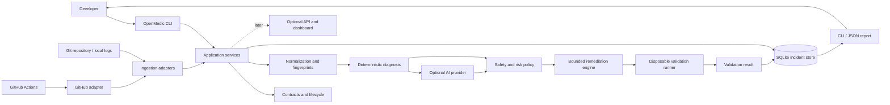
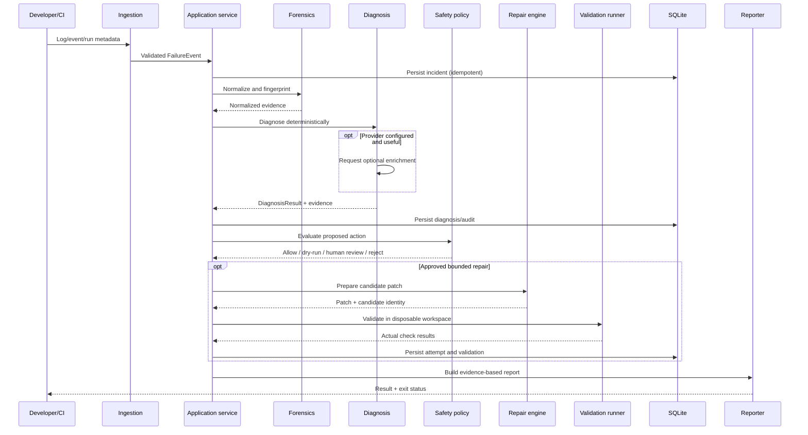
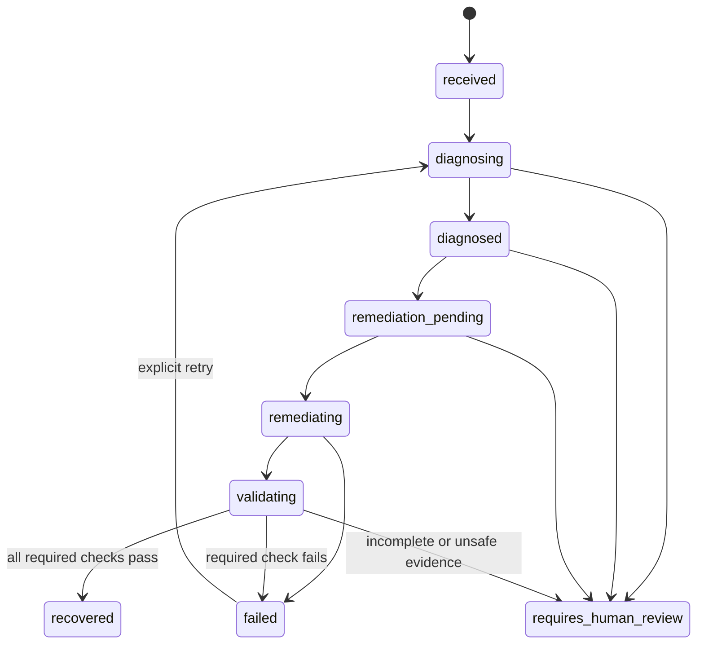

# OpenMedic — System Architecture

## 1. Architectural rule

**Collect evidence → normalize → diagnose → propose a bounded action → enforce policy → validate in isolation → report honestly.**

The CLI is the first interface, not the application core. OpenMedic must run locally without a server. GitHub Actions is the first live CI integration. API and dashboard are optional later interfaces.

## 2. Context diagram

## 3. Module boundaries

- **CLI:** user interaction, argument validation, output formatting, exit codes.
- **Application services:** use-case orchestration. Must be callable by CLI, API, and CI adapters.
- **Domain/contracts:** schemas, enums, lifecycle invariants, errors, safety policy interfaces.
- **Ingestion:** parse log files, stdin, fixtures, and CI run metadata into common events.
- **Forensics:** normalize volatile log content, preserve raw evidence, generate fingerprints.
- **Diagnosis:** deterministic rules and evidence selection; optional AI enrichment.
- **Provider adapters:** translate provider-specific request/response formats into the internal protocol.
- **Remediation:** playbook selection, diff generation, patch validation, risk evaluation.
- **Validation runner:** execute allowlisted checks against a disposable candidate.
- **Persistence:** SQLite repositories and migrations.
- **Reporting:** terminal and JSON reports; later GitHub comments/PRs and UI.
- **Optional API:** thin transport layer over application services.

## 4. Main sequence

## 5. Deployment modes

### Mode A — Local CLI (first)
- Runs on the developer's machine.
- Local SQLite history.
- Log/fixture ingestion and deterministic diagnosis work offline.
- No public endpoint or OpenMedic account required.

### Mode B — GitHub Actions integration
- Runs as a workflow/action or connects to GitHub Actions using a scoped token.
- Read-only diagnosis is the initial integration mode.
- Optional report/comment/PR capabilities require separate explicit permissions.
- Can run per workflow or as a self-hosted process; choose the simplest reliable approach during implementation.

### Mode C — Self-hosted API/dashboard (later)
- Optional service for webhooks, team access, and UI.
- May run on a VPS, private server, or developer-owned machine.
- Webhooks require a reachable endpoint or a secure tunnel; polling/workflow-triggered operation may avoid inbound public webhooks.
- Service deployment must not become a dependency for the local CLI.

## 6. Trust boundaries

1. Logs, repository files, CI metadata, and issue/commit text are untrusted.
2. Model output is untrusted, even from a configured provider.
3. The remediation runner is a separate trust boundary with limited privileges and resources.
4. Secrets must not enter prompts, persistent incident records, reports, or test fixtures.
5. GitHub write permissions are separate from read permissions.
6. Human review is required for high-risk or ambiguous changes.

## 7. State machine

Invariant: recovery is tied to a specific candidate patch and successful required checks. Any patch change invalidates prior validation.

## 8. Architectural decisions

- Keep CLI and optional API thin.
- Keep deterministic diagnosis independent of provider adapters.
- Keep CI-specific integrations behind adapter interfaces.
- Keep storage behind repositories/services.
- Keep repair execution separate from diagnosis and policy.
- Keep validation results immutable/auditable per attempt.
- Do not implement the dashboard before core end-to-end functionality is reliable.
